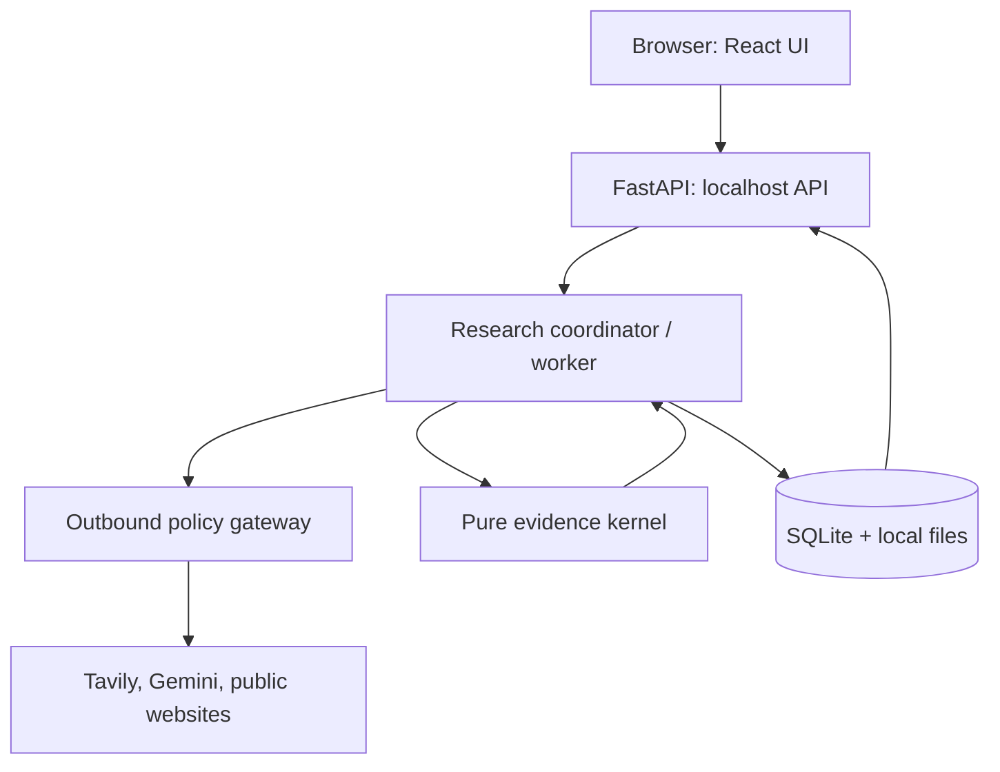
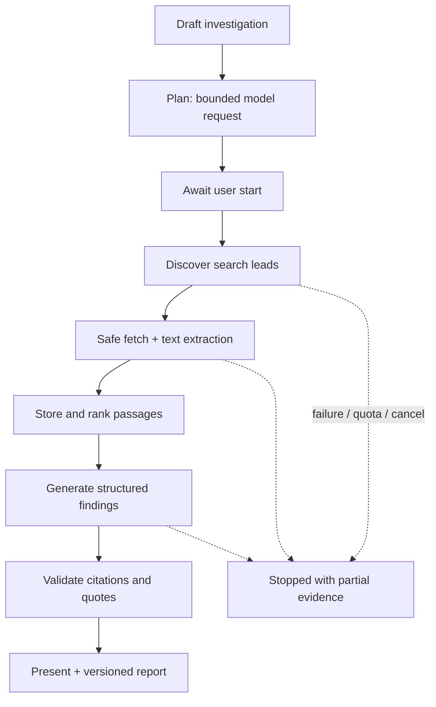

# DeepTrace AI — System Architecture

**Version:** 1.0.0

**Date:** 2026-10-24

**Status:** Approved architecture specification; implementation not authorized by this document

**Context:** Solo developer, Windows-first, single-user, local-first, free-only MVP
**Normative inputs:** `PRD.md` v1.1.0, `docs/DESIGN.md` v1.0.0, `docs/INTEGRATIONS.md` v1.0.0

## 1. Purpose and authority

DeepTrace AI investigates a question, discovers and retrieves public evidence, retains source-level provenance, generates a qualified research answer, checks references and quotations deterministically, and produces a versioned Markdown report. In M2 it adds text-based PDF research and local semantic retrieval; in M3 it separately evaluates whether cited passages support the claims they accompany.

This document records the owner's approval of a **modular monolith**, the revised architecture review, and **three smaller foundation sprints**. It specifies implementation boundaries without claiming components or external integrations are already working. The PRD controls product scope and acceptance criteria; DESIGN controls UI and accessibility; INTEGRATIONS controls provider choice, free-only operation, data boundaries, PDF stack and licensing. In case of disagreement, record the conflict and obtain an explicit owner decision rather than silently rewriting another document.

## 2. Architecture decision register

| ID | Decision | Status and rationale |
|---|---|---|
| ADR-A01 | One local FastAPI modular monolith, one SQLite database, one controlled application data directory | Approved; minimum deployment complexity for Windows solo development. |
| ADR-A02 | React/TypeScript/Vite/Tailwind frontend; DESIGN's Chart Room tokens, navigation, accessibility and states | Approved; no generic redesign. |
| ADR-A03 | Development uses Vite `/api` proxy; packaged release serves built assets and `/api` from one FastAPI origin | Approved; same-origin reduces but does not eliminate local request-security obligations. |
| ADR-A04 | Pure evidence kernel with no I/O; separate schema/reference validity, quote fidelity and semantic-support evaluation | Approved; semantic assessment is M3, not implied in M1 by valid IDs. |
| ADR-A05 | Plain bounded staged orchestrator with durable checkpoints; defer LangGraph | Approved; re-evaluate only if branching complexity warrants it. |
| ADR-A06 | One controlled local worker for M1, bounded synchronous HTTP calls and progress polling around 1 Hz | Approved provisionally, subject to lifecycle/concurrency tests. No background work in FastAPI request scope. |
| ADR-A07 | SQLite with WAL, foreign-key checks and small repositories plus numbered migrations | Approved starting point, subject to concurrency and migration tests; transactions are short. |
| ADR-A08 | Central outbound policy gateway for live providers and website requests, with specialized SSRF-safe fetch transport | Approved; gateway is policy choke point, not proof that underlying network behavior is safe. |
| ADR-A09 | Mock by default; Tavily and free-tier eligible Gemini only after opt-in and account verification | Approved per INTEGRATIONS. No automatic paid service. |
| ADR-A10 | M1 bounded lexical passage ranking; M2 FastEmbed BGE-small-en-v1.5 plus SQLite/NumPy exact search | Approved; embeddings not required to deliver M1. |
| ADR-A11 | M2 `pypdf` + `pypdfium2`; Apache-2.0 application licensing and third-party notices | Approved per INTEGRATIONS. |
| ADR-A12 | React Router, TanStack Query, existing DESIGN component choices; typed OpenAPI schemas where practical | Proposed implementation tools; confirm compatibility during scaffold, avoid dependency proliferation. |
| ADR-A13 | Conservative `robots.txt` policy: if retrieval/permission cannot be established, skip that host for the run and report it | Approved safety default; do not circumvent site restrictions. |
| ADR-A14 | Quote matching: NFC normalization and whitespace collapse, case-sensitive, no paraphrase/fuzzy acceptance | Approved baseline; offsets remain defined on the unnormalized saved extraction. |
| ADR-A15 | Small three-sprint foundation followed by remaining M1, M2, M3 and M4 | Approved; each sprint has independent exit criteria. |

## 3. Component context



- **UI:** renders design-system screens, research progress and evidence details; it never receives raw API keys or accesses the database directly.
- **API:** validates requests, maps typed errors, checks request origins, coordinates state changes and returns sanitized representations.
- **Orchestrator:** owns persisted stage transitions, budgets, cancellation and restart recovery. It asks providers for data through the gateway.
- **Outbound gateway:** enforces mode, provider/model allowlists, consent, sensitive-data flags and budget/quota decisions. Specialized safe-fetch code additionally enforces DNS/connection and redirect security.
- **Evidence kernel:** computes stable passage boundaries and references, normalizes quotes, validates citation authority and declares which claims are merely cited. No I/O.
- **Storage:** persists investigations, runs, source text, passages, claims, references and immutable report versions; keeps secrets outside SQLite.
- **Later additions:** M2 document extractor, embeddings and retriever; M3 semantic assessment/evidence comparison. All remain internal modules, not separate services.

## 4. Runtime topology and security boundaries

### 4.1 Development and release

- Development: Vite frontend on a configured loopback port proxies `/api` to FastAPI on `127.0.0.1`. Do not expose the backend on all interfaces. Accept only explicitly configured development frontend origins.
- Release: FastAPI serves built static frontend and JSON API from one allowed localhost origin; do not require a separate frontend server. Do not claim same-origin alone prevents CSRF or localhost attacks.
- Protect state-changing endpoints and secret updates with validated `Host`/`Origin`, an explicit approved same-origin or session-token/CSRF strategy, strict request content types and tests for hostile browser pages, absent `Origin`, local malicious clients and DNS rebinding against the local server. Document residual threats; loopback is not authentication.
- Local data directory is generated/controlled separately from the repository; database, user uploads, caches and exports are Git-ignored and not served as static files. Use safe file IDs/paths, symlink checks and bounded deletions.

### 4.2 Single worker lifecycle

- M1 permits one active run at a time across the local application. Starting a second run returns a typed conflict. An **atomic database claim** transitions `Queued` to `Running`, preventing two workers from claiming the same run after an API race/restart.
- The worker is managed by application startup/shutdown lifecycle, **not** by request-scoped background tasks or an uncontrolled thread per request. Shutdown stops admission, signals cancellation, waits a bounded grace period and leaves unfinished work marked `Interrupted` at next startup.
- External operations use timeouts and bounded retries; cancellation is cooperative and may not interrupt a request immediately. UI must say `Cancelling` until a terminal state is persisted.
- Stage input/output is checkpointed atomically with its completion marker. **Never hold a SQLite transaction open during network calls, model inference or PDF parsing.** On restart, sweep stale `Planning`/`Running` rows to `Interrupted`; show saved evidence. Full automated resume is M3/M4.
- Unique keys, fingerprints and transactions prevent duplicate *local* rows. External provider calls might have completed before a crash; no promise of exactly-once billing/usage across crashes.
- Document a later queue/process alternative if high-load or multiuser support becomes necessary; do not build it in M1.

## 5. Research workflow and state model



Stages have explicit typed inputs and outputs. Planned subquestions/search queries are trimmed deterministically to fit both provider-level limits and PRD FR-11. Discovery results are **leads**, never citations until corresponding page content has been safely fetched and saved. An unextractable, blocked or paywalled source receives an honest source status and cannot be represented as fully read.

**Investigation states:** `Draft`, `Planning`, optional `Awaiting approval`, `Running`, `Completed`, `Budget reached`, `Cancelled`, `Failed`, `Interrupted`, `Archived` and `Deleted`, consistent with PRD §11. The UI may display `Paused` only if a later feature introduces a producer; do not expose a nonfunctional pause action in M1. Only normal successful termination is `Completed`. Persist state transition/event timestamps and enforce transitions with domain logic.

**Planning vs research runs:** Keep both distinct. Planning can propose a bounded strategy before explicit `Start research`; revisions/plan editing are later Should features. Report state includes whether output is simulated mock research or actually fetched live research.

## 6. Evidence semantics: the trust boundary

Three distinct properties must never be merged:

1. **Reference validity (M1):** cited passage ID exists, is active, belongs to the current investigation and was among allowed evidence passages for that run/claim. Never trust a model-generated ID merely because it looks valid.
2. **Quote fidelity (M1):** quoted text, after precisely documented NFC and whitespace normalization, matches a contiguous excerpt from the stored extracted passage. Case-sensitive; no fuzzy matching. Quote matching does not establish truth.
3. **Semantic support (M3):** a separate, fallible assessment of whether a passage entails the claim, with provenance, method, model and review label. It may conclude `Supported`, `Uncertain`, `Contested` or `Unsupported`; do not present automated labels as proof.

Before M3, claim presentation uses `Cited` or **`Not established`**, plus a prominent notice that syntactically valid citations do not demonstrate substantive support. Invalid citations/quotes are suppressed, not displayed with a false “verified” label. Findings with inadequate evidence disclose limitations and needed sources.

**Offsets:** Web passages refer to character ranges of the **persisted, versioned extracted text**, not the original HTML. Preserve extraction version, normalization version and immutable source text snapshot. PDF passages are page-scoped and carry physical page index and reliable optional printed label. The UI opens stored context and highlights where offsets remain reliable.

**Prompt boundary:** Web/PDF content is untrusted data, never trusted instructions. Version prompts; pass only a bounded allowed set of passage IDs and excerpts. Model output is validated to typed schema; it cannot directly initiate unrestricted network/file/tool actions. Adversarial fixture testing (at least 20 cases) is a release requirement.

## 7. Outbound policy gateway and provider contracts

`SearchProvider`, `LLMProvider`, `EmbeddingProvider`, `WebFetcher` and `DocumentExtractor` expose versioned typed request/result/error contracts independent of vendor SDKs. Mock adapters satisfy the same contract as live adapters. The provider library must not know SQL schema details.

Each outbound request is admitted only after checks for:

1. Current mode: `mock`, `offline` or `live_free`; mock/offline modes prohibit real provider calls.
2. Allowed provider, model identifier and destination; no arbitrary user-supplied API base URL.
3. Up-to-date provider/purpose disclosure and explicit, revocable consent.
4. Sensitive content rule: do not send sensitive investigation material to Gemini. Uploaded PDF originals are local; M2 document-derived passage transmission requires explicit snippet preview and authorization.
5. Per-run and per-provider operation/credit/token/time budgets, checked **before** reservation and finalized/adjusted afterward. Record unknown usage as estimated/unknown, never fabricate exact cost.
6. Provider account's actual free-tier status; **a call described as a 'free eligibility check' cannot be assumed free**. Prefer official dashboard/metadata evidence, avoid speculative generation/search calls, and require owner opt-in for any smoke call that could consume credits.

Provider key storage: Windows OS credential store when validated; untracked protected `.env` in development only. Never store credentials in SQLite, source code, frontend bundles, responses, logs or reports. Credential settings are write-only and mask state. Consent revocation blocks **new** calls but cannot retract already transmitted material.

**Free-only is a policy plus an account/configuration property, not a mathematically enforceable guarantee from a boolean flag.** No pay-as-you-go fallback, no provider substitution, no unbounded retries. Unknown tier status disables live mode until verified. Official provider quotas/terms are rechecked at onboarding and release; code must gracefully handle changing quotas and model availability.

## 8. Secure fetching architecture

For each webpage candidate, the fetch service:

- Accepts only explicitly allowed `http`/`https` URLs; rejects credentials, unsafe schemes, ambiguous/encoded hosts and unsupported ports according to documented policy.
- Resolves and evaluates **all** IPv4/IPv6 results; rejects loopback, private, link-local, reserved, metadata and mixed forbidden addresses.
- **Pins or otherwise controls the actual network connection destination to the address that passed validation**, with correct TLS hostname verification and SNI for HTTPS; repeats the entire policy and connection check on every redirect. A pre-request DNS check followed by HTTPX's ordinary re-resolution is insufficient. Verify this experimentally with a custom transport or equivalent approach before enabling public live fetching.
- Caps requests at PRD initial limits: 15-second timeout, 5 MB safe decompressed response size, five redirects. Enforces allowed response types, content sniffing, bounded robots checks and reasonable rate limits.
- Honors robots.txt and terms; unknown robots permission fails closed for that host/run. Does not bypass access controls, CAPTCHA, paywalls or JavaScript-only restrictions.
- Records original/canonical URL when trustworthy, timestamp, author/date only if known, extraction version, status and text; Trafilatura output is sanitized before rendering.

**Release gate:** DNS rebinding, redirect-to-private, encoded address, IPv6, proxy bypass and mixed-address fixtures must prove the fetcher cannot connect to forbidden destinations. If connect-time pinning cannot be safely implemented with the chosen HTTP stack, do **not** ship live arbitrary URL fetching; remain on mock fixtures or use a separately reviewed constrained alternative.

## 9. Persistence and database boundaries

M1 tables (logical entities; exact DDL belongs in `DATABASE.md`):

| Group | Tables / responsibility |
|---|---|
| Configuration | `schema_meta`, nonsecret `settings`, `provider_consents` with version and revocation |
| Investigation | `investigations`, `plans`, `plan_items` |
| Execution | `runs`, `run_stages`, `run_events`, `provider_usage` |
| Research | `search_queries`, `sources`, `passages` |
| Answer | `answers`, `claims`, `citations` |
| Reporting | `report_versions` with immutable content hash, version and mode label |

M2 adds `documents`, `document_pages`, `embeddings` and `index_versions`; M3 adds `claim_assessments` and optional stance/reviewer overrides. Constrain every source, passage and citation to an investigation, enforce foreign keys on every connection, and validate ownership in application queries—not just in the UI. WAL and short write transactions are baseline; benchmark concurrency.

**Deletion:** User-confirmed deletion is a tested, multi-step operation that accounts for DB rows, file storage, embeddings and interruption/partial failure. Mark deletion incomplete when any artifact remains. Deleting a PDF retires its source/passages and active citations; the UI must show `Source removed` rather than resolving to nonexistent evidence. Previously generated Markdown report versions remain **byte-for-byte immutable**. When viewing them, display an *external contextual warning* about removed/invalidated sources, without rewriting the historical stored report; new report versions can include revised status. Reports and deleted source metadata require a clearly defined retention policy and privacy disclosure—do not preserve sensitive tombstones without justification.

## 10. M1 API boundary (planning contract)

All routes are under `/api` unless noted. Request and response JSON schemas are typed, with a stable error object such as `{error:{code,message,what_failed,what_saved,next_step}}`. The exact OpenAPI contract is finalized before implementation.

| Method | Route | Purpose |
|---|---|---|
| GET | `/api/health`, `/api/capabilities` | Local readiness and milestone/provider capability gating; no secrets |
| GET/PUT | `/api/settings` | Nonsecret settings and bounded run limits |
| GET | `/api/providers` | Provider mode, availability, consent and masked credential state |
| PUT/DELETE | `/api/providers/{id}/credential` | Write-only credential install/removal with local request protections |
| POST/DELETE | `/api/providers/{id}/consent` | Versioned consent grant/revocation |
| GET/POST | `/api/investigations` | List/create local investigations |
| GET/PATCH/DELETE | `/api/investigations/{id}` | Read, rename/archive, verified delete |
| POST | `/api/investigations/{id}/runs` | Queue bounded `plan` or `research` run; return 202 and run ID |
| GET | `/api/runs/{id}` | Poll stage, status, progress, budgets and failure/recovery note |
| POST | `/api/runs/{id}/cancel` | Cooperative cancellation |
| GET | `/api/investigations/{id}/plan` | Retrieve bounded plan |
| GET | `/api/investigations/{id}/events` | Cursor-based run activity, secrets excluded |
| GET | `/api/investigations/{id}/sources`, `/api/sources/{id}` | Source list and saved extraction details |
| GET | `/api/passages/{id}` | Validated evidence drawer context, including removed-source response |
| GET | `/api/investigations/{id}/answer` | Claims, evidence state, limitations and citations |
| POST/GET | `/api/investigations/{id}/reports` | Create version (revalidate), list versions |
| GET | `/api/investigations/{id}/reports/{version}` | Immutable report preview and current source-status context |
| GET | `/api/investigations/{id}/reports/{version}/download` | Safely named Markdown attachment |

**API guardrails:** validate payload sizes and fields, strict state transitions, idempotent operations where appropriate, error redaction, safe `Content-Disposition`, `nosniff`, predictable HTTP status codes and consistent localhost request-origin checks. `GET /api/health` is liveness; a separate optional readiness report can indicate DB/migration status without leaking configuration. No user account/login in local single-user MVP, but no assumption that every browser page or local process is trusted.

## 11. Frontend and user experience

Follow DESIGN's color values, typography, focus rings, responsive navigation, evidence drawer, labels, status copy and accessibility behavior. Use capability flags for milestone-later routes rather than presenting dead controls.

- M1 screens: dashboard, new investigation, plan, research workspace, sources, evidence drawer, report preview/export and provider setup/settings.
- Show a global **Simulation / Mock mode** banner and mock watermark in downloaded reports. No simulated citations may be presented as live research.
- Show explicit statuses for quota exhausted, unavailable, consent revoked, offline and interrupted. Free-tier/quota messaging is primary; dollar estimates are only displayed if accurate and relevant (no paid usage in the MVP).
- Gemini free-tier disclosure appears before live activation and in Settings. Sensitive-investigation toggle appears early; document snippet preview/authorization is added in M2.
- Poll one active run at a practical interval around 1 second while visible; slow/stop polling when backgrounded or terminal. Avoid accumulating requests.
- Render Markdown without executable HTML, sanitize external links, never load remote source images by default; preserve focus management, keyboard access and reduced-motion behavior.

These are **required design addenda**, not permission to replace the original palette or redesign the product. Prepare a focused DESIGN revision separately with owner review.

## 12. Milestone plan and three foundation sprints

The three sprints are **sequential foundations within M0/M1**, not replacements for the PRD M1–M4 milestones. Durations are estimates to be measured, not deadlines.

### Sprint 1 — Running project foundation

**Build:** Minimal Python/FastAPI app, mock-first configuration, loopback binding, `/api/health`, `/api/capabilities`, React/TypeScript/Vite/Tailwind shell adhering to DESIGN, Vite proxy and basic lint/test scripts. Add safe ignore rules and current Apache-2.0 project license only when the implementation task is authorized. No real keys.

**Exit:** Backend health endpoint and dark responsive frontend load on Windows; no secrets/data tracked; tests, frontend build and lint pass. No real outbound requests. Avoid a fully featured dashboard in this sprint.

### Sprint 2 — Persistent investigations and evidence kernel

**Build:** SQLite migration runner, investigation create/list/read and minimal dashboard, pure passage/reference/quote validators and unit tests. Validate WAL and FK behavior, local Origin/Host request policy and restart persistence.

**Exit:** Create an investigation, restart the backend and see it again; fabricated passage IDs and altered quotes are rejected; the database schema migrates idempotently; local request guards are tested. No live web search.

### Sprint 3 — Complete simulated research journey

**Build:** Mock `SearchProvider`/`LLMProvider`, stage checkpoints, safe fixture fetching, extraction, lexical ranking, typed synthesis, reference validation, source/evidence drawer, report generator and mock-mode banner. Begin policy-gateway and SSRF fixture suite; do not bypass the live-fetch security release gate.

**Exit:** User creates an investigation, starts a fully deterministic mock run, sees cited/not-established findings, opens a stored passage and downloads a correctly labeled Markdown report. Quota/cancel/invalid-response fixtures retain partial results; tests run offline with no API keys. A mock milestone is not reported as completed live research.

### Complete M1 after Sprint 3

- Finish setup wizard, credential store, consent and outbound gate; verify local server request protection and SSRF-safe real transport.
- Perform opt-in, minimal Tavily/Gemini live smoke validation **only** after model/account/free-tier and outbound-data consent checks.
- Exercise PRD AC-01/02/03/06/09/11 and UX/security tests. If provider access is unavailable, document `mock-only` completion honestly rather than claiming live M1.

### M2 — Text PDF/RAG

- Controlled upload with 25 MB/300 pages/10 files defaults, corruption/encryption/scanned flags and extraction-quality notices.
- Page-preserving pypdf/pypdfium2 extraction, stable passage IDs, local FastEmbed `BAAI/bge-small-en-v1.5`, SQLite BLOB vectors and NumPy scoped top-k exact retrieval (default 8).
- Index versioning, deletion and reindexing tests, laptop benchmarks and bundled PDFium/model license audits.
- Document-derived snippet preview/authorization; raw PDF files never automatically leave the machine.

### M3 — Evidence intelligence

- Separately evaluated fallible semantic-support labels with method/model metadata and human-reviewed calibration; evidence compare, source indicators and explicit conflicts when promoted from Should.
- Resume incomplete runs without local duplication, preserving the external-call duplication caveat. Consider LangGraph only after a recorded architecture decision.

### M4 — Release hardening

- Full SSRF/prompt-injection/privacy suites, dependency and license scans, accessibility and Windows setup/packaging, reference-machine performance benchmarks, documentation traceability and usability evaluation.
- No known unsafe SSRF/injection behavior in release fixtures; explicitly document remaining risks. Release only when applicable PRD acceptance criteria are satisfied.

## 13. Test matrix and quality gates

| Layer | Required checks | Offline by default? |
|---|---|---|
| Domain/evidence | Property/unit tests for ID ownership, normalized quotes, offsets, deleted passages, schema validation | Yes |
| Database | Migration/rollback, foreign keys, WAL concurrency, restart, idempotency and deletion partial failures | Yes |
| Provider interface | Mock/live contract shape; 429, quota, outage, timeout, malformed JSON, cancellation, no paid fallback | Yes via mocks |
| Fetcher | IPv4/IPv6, DNS rebinding, redirect-to-private, decompression, robots failure, content limits, hostile URLs | Yes via isolated fixtures |
| Research | Plan budgets, checkpoints, evidence passage provenance, cited/not-established labeling, report versioning | Yes |
| API/security | Local Host/Origin protections, cross-origin browser attempts, secret redaction, prompt injection (≥20) | Yes |
| Frontend | Responsive five-width smoke, focus/drawer keyboard, mock-state labeling, axe + manual passes | Yes |
| Live providers | Small approved public Tavily query and synthetic Gemini prompt; actual quota and region evidence | No; opt-in only |
| Packaging/license | Fresh Windows setup, Apache notices, PDFium binaries, model/font licenses, secret/vulnerability scans | Mostly |

Track deterministic citation validity and quote fidelity separately from human-evaluated semantic groundedness. PRD AC-06 requires 100% of **displayed** IDs and quotations to pass code validation, while semantic support is sampled and independently reported. Do not equate passing fixture tests with universal security or accuracy.

## 14. Proposed repository modules

```text
DeepTrace-AI/
  PRD.md
  README.md
  LICENSE                       # Apache-2.0, add on authorized setup sprint
  docs/
    DESIGN.md
    INTEGRATIONS.md
    ARCHITECTURE.md
    DATABASE.md                 # subsequent separately approved artifact
    adr/                        # future decisions as needed
  backend/
    pyproject.toml
    src/deeptrace/
      main.py
      api/
      domain/
      orchestration/
      providers/
      gate.py
      web/
      evidence/
      reports/
      storage/
      security/
      prompts/
      pdf/                      # M2
      retrieval/                # M2
    tests/
  frontend/
    src/
      app/
      features/
      components/
      api/
      styles/
      test/
    e2e/
  fixtures/
  scripts/
  data/                         # local and gitignored
```

Only create folders/files a sprint actually needs; the tree describes eventual ownership, not an instruction to scaffold all modules immediately.

## 15. Known inconsistencies and separate documentation updates

| Source issue | Resolution recorded here | Follow-up |
|---|---|---|
| PRD §20 provisionally names PyMuPDF/Chroma | INTEGRATIONS selects pypdf/pypdfium2 and SQLite/NumPy | Small PRD revision + ADR after owner review |
| PRD D-05 proposed LangGraph | Defer; bounded plain pipeline for M1 | Update decision status in PRD |
| DESIGN lacks mock banner, quota/consent states | Explicit mock indication and new states are required | Focused DESIGN addendum |
| DESIGN's cost estimations vs free-only | Show free-tier status; never infer chargeable usage | Focused DESIGN copy updates |
| Sensitive toggle and PDF snippet preview | M1 sensitive mark, M2 explicit snippet consent | DESIGN/PRD reconciliation |
| PDF source removal and immutable report versions | Do not mutate historical bytes; show contextual current-status warning | DATABASE/API contract |
| Robots permission when unavailable | Fail closed for that host/run | Security decision logged here |
| PRD search plan can exceed run search ceiling | Deterministically trim plan before execution and disclose omissions | Pipeline budget tests |

Do not automatically update the PRD, DESIGN or INTEGRATIONS as part of creating this file. Their reconciliation requires a scoped review.

## 16. Open engineering validation and ownership checkpoints

Before Sprint 1 implementation: verify local Windows Python/Node/tool availability and Git state; agree to repository changes and dependency setup. During Sprint 1/2: test Windows credential-store adapter, strict local request protections and SQLite concurrency. Before live M1: prove actual SSRF-safe connect behavior; confirm Tavily/Gemini account free status, privacy terms and provider limits. Before M2: verify PDFium and model redistribution notices, first-run model download, Windows embedding performance, PDF text fidelity and deletion semantics. Before M3: select reviewer/calibration fixtures for semantic claim support.

**Approval boundary:** This document specifies architecture only. It does not authorize changing `PRD.md`, `DESIGN.md` or `INTEGRATIONS.md`; creating the database specification; installing dependencies; using API keys; implementing software; or pushing Git commits. Obtain owner approval for each next scoped phase.
