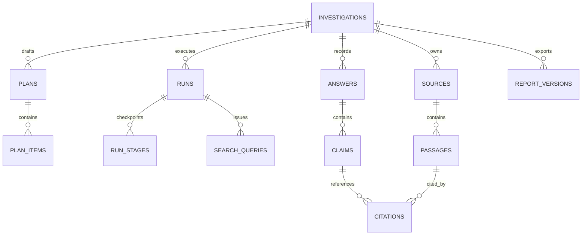

# DeepTrace AI — Database Design Specification

**Version:** 1.0.0

**Date:** 2026-10-24

**Status:** Proposed database specification for owner review; no schema or application code implemented

**Inputs:** `PRD.md` v1.1.0, `docs/DESIGN.md` v1.0.0, `docs/INTEGRATIONS.md` v1.0.0, `docs/ARCHITECTURE.md` v1.0.0

## 1. Purpose, scope and principles

DeepTrace AI is a single-user, local-first research investigation application. The database must preserve exact source provenance, deterministic citation validity, stage checkpoints, free-tier usage records, consent history and immutable report versions. SQLite is the approved relational store. Uploaded PDFs and large model artifacts are stored in a controlled local directory, **not** as arbitrary filesystem paths or secrets inside the database.

This specification defines **logical tables, columns, keys, invariants, indexes, lifecycle and tests**, but does not create a `.db` file or migration. The implementation should add only the tables needed for the current sprint; M2 and M3 extensions are explicitly deferred.

Core rules:

1. A passage belongs to one source and one investigation; citations must never cross investigation boundaries.
2. Search snippets are discovery leads, not source passages eligible for evidence citations until a permitted fetch/extraction has succeeded.
3. An existing citation ID or matching quote does **not** prove semantic support.
4. Source content is versioned/snapshotted so offsets refer to the exact saved extracted text.
5. Report versions are immutable snapshots; later source deletion is shown through **separate current-status metadata**, not by altering past report bytes.
6. Credentials are never stored in SQLite. API keys go to a validated OS secret store or protected untracked development config.
7. Provider free-tier usage counters and consent records are local bookkeeping, not authoritative provider billing data.

## 2. Milestone boundaries

| Milestone | Tables and responsibility | Excluded |
|---|---|---|
| Foundation Sprint 1 | No production schema required; backend/app connectivity only | No real DB implementation yet |
| Foundation Sprint 2 | `schema_meta`, `settings`, `investigations`; minimal evidence-kernel fixtures may remain in-memory | No live runs or reports |
| Foundation Sprint 3 / M1 | `provider_consents`, `plans`, `plan_items`, `runs`, `run_stages`, `run_events`, `provider_usage`, `search_queries`, `sources`, `passages`, `answers`, `claims`, `citations`, `report_versions` | No PDF/embeddings/semantic assessments |
| M2 | `documents`, `document_pages`, `embeddings`, `index_versions`; optional ingestion jobs | No OCR |
| M3 | `claim_assessments`, optional `stance_labels`, `user_overrides` | No premature semantic-support score in M1 |

## 3. Entity relationships

Supporting relationships: runs own events and provider-usage entries; sources can optionally link to M2 documents; M2 document pages own page-scoped passages; M2 embeddings reference passages; M3 assessments reference claims and a disclosed evaluation method. Consent belongs to a provider/purpose/disclosure version, **not** an API key record.

## 4. Identity, timestamps and storage conventions

- Use stable application-generated opaque IDs (e.g., UUID strings) as primary keys for external references; avoid sequential global database IDs in URL-facing APIs. A local integer rowid may be an internal optimization only.
- Store UTC timestamps as explicitly normalized ISO-8601 strings or integer Unix epoch milliseconds; choose one convention and test it. Display local timezone only in the UI.
- Store enumerated state as constrained text plus versioned application enums; migrations must precede new state values.
- Store boolean flags as SQLite integers with `CHECK (flag IN (0,1))`; create checks for numeric limits and nonnegative usage.
- Use `NOT NULL` for true invariants; use `NULL` for unknown author/publication date/page labels, never made-up defaults.
- Distinguish `created_at`, `updated_at`, `fetched_at`, `extracted_at`, `assessed_at`, `deleted_at` and report-generation timestamps rather than reusing a misleading generic date.
- Store content hashes as SHA-256 hex strings with a documented normalization/input representation, not as evidence of authenticity.
- Do not put raw prompts containing research passages, provider secrets or token-bearing URLs into normal logs.

## 5. M1 table specifications

### 5.1 `schema_meta`

| Column | Rule |
|---|---|
| `version` | Primary key integer migration version, positive |
| `applied_at` | UTC timestamp, required |
| `checksum` | Hash of exact migration SQL, required |

Migrations execute sequentially and atomically where SQLite DDL permits. Fail on unexpected prior checksum changes; do not reapply a modified historical migration silently.

### 5.2 `settings`

| Column | Rule |
|---|---|
| `key` | Primary key allowlisted setting name |
| `value_json` | Validated JSON, never contains credentials |
| `schema_version`, `updated_at` | Required |

Settings include mock/offline/live-free mode and user-adjustable run limits bounded by hard maxima. **No API key, access token, raw credential or credential-backed URL is permitted.** Store secret *state* separately from the secret itself.

### 5.3 `provider_consents`

| Column | Rule |
|---|---|
| `id` | PK |
| `provider_id`, `purpose`, `disclosure_version` | Required; named role and accepted disclosure version |
| `granted_at` | Required timestamp |
| `revoked_at` | Nullable timestamp; cannot precede grant |

Keep historical consent and revocation rows for local audit. Only the latest unrevoked consent for the current version/purpose may authorize new outbound requests. A key on disk does not imply consent. Avoid recording sensitive research contents in consent rows.

### 5.4 `investigations`

| Column | Rule |
|---|---|
| `id` | PK |
| `title`, `question` | Required after application validation; title can be generated from question |
| `status` | Constrained state; e.g., `draft`, `planning`, `ready`, `running`, `completed`, `budget_reached`, `cancelled`, `failed`, `interrupted`, `archived` |
| `sensitive` | Required boolean, default false; blocks hosted passage transmission when true |
| `created_at`, `updated_at` | Required UTC timestamps |
| `archived_at` | Nullable UTC timestamp |

Question-edit behavior is an open product decision. For M1, prefer treating a run's question as an immutable **run configuration snapshot**; editing investigation text never retrospectively changes completed run evidence or reports. Application deletion is a separate controlled operation, not merely setting `status='deleted'`.

### 5.5 `plans` and `plan_items`

`plans`: `id` PK, `investigation_id` FK, `originating_run_id` nullable FK, `revision_no` positive, `prompt_version`, `provider_id`, `model_id`, `created_at`, `approved_at` nullable; unique `(investigation_id,revision_no)`.

`plan_items`: `id` PK, `plan_id` FK, `ordinal` positive, `sub_question`, `search_query`, `is_enabled`, `omission_reason` nullable; unique `(plan_id,ordinal)`.

Every generated plan is validated against remaining run/provider budgets. Save skipped/trimmed queries with an omission explanation when needed; planned queries are not evidence.

### 5.6 `runs` and `run_stages`

`runs`: `id` PK; `investigation_id` FK; `kind` (`plan`/`research`); `status` (`queued`, `planning`, `running`, `completed`, `failed`, `cancelled`, `budget_reached`, `interrupted`); `mode` (`mock`, `live_free`); `plan_id` nullable FK; bounded `config_snapshot_json`; `question_snapshot`; `started_at`/`finished_at` nullable; `created_at`; `cancel_requested` boolean; `worker_claim_token` nullable opaque token; `last_heartbeat_at` nullable; `error_code` nullable.

`run_stages`: `id` PK; `run_id` FK; `stage_key` constrained (`plan`,`discover`,`fetch`,`extract`,`rank`,`synthesize`,`validate`,`report`); `stage_revision` integer; `status`; `started_at`/`completed_at`; `output_ref_json` containing **IDs/hashes and bounded metadata**, not unbounded extracted content; `error_code` nullable; unique `(run_id,stage_key,stage_revision)`.

**Atomicity:** claim a queued run using a conditional `UPDATE` inside a short transaction; only one claim succeeds. Write stage output and completed checkpoint in a single transaction, after any network work has returned. Never hold a transaction across HTTP/model work. On startup, convert stale running/planning rows to `interrupted` and preserve completed checkpoints. Automated resume remains M3/M4.

### 5.7 `run_events` and `provider_usage`

`run_events`: `id` PK; `run_id` FK; `sequence_no` monotonically increasing per run; `event_type`, `stage_key` nullable, `safe_message`, `created_at`; unique `(run_id,sequence_no)`. Never log credentials, raw sensitive snippets or full provider prompts.

`provider_usage`: `id` PK; `run_id` FK; `provider_id`, `operation`, `attempt_no`, `requested_at`, `finished_at` nullable, `status`, `reported_units_json` nullable, `estimated_units_json` nullable, `quota_state` nullable; `is_estimate` boolean; optional nonsecret `provider_request_id`. Differentiate unknown, estimated and reported usage. Record attempts including failed ones without claiming exact billing/credit accounting.

### 5.8 `search_queries`

`id` PK; `run_id` FK; `investigation_id` FK; `query_text`, `provider_id`, `status`, `searched_at` nullable, `results_count` nullable, `credits_reported` nullable, `usage_id` nullable FK. Enforce query length and per-run query budgets. Search result URLs become candidate source records but do not become cited evidence until source content is fetched and extracted.

### 5.9 `sources`

| Column | Rule |
|---|---|
| `id` | PK |
| `investigation_id` | Required FK |
| `source_type` | `web` in M1, `pdf` added M2 |
| `original_url`, `canonical_url` | Nullable for PDF; validated/sanitized web URLs |
| `title`, `author`, `published_at` | Nullable when not known |
| `status` | One of `fetched`, `partial`, `blocked`, `paywalled`, `failed`, `duplicate`, `unsupported`, `removed` |
| `extracted_text`, `text_sha256` | Saved text and content hash; nullable when fetch failed |
| `extraction_version`, `normalization_version` | Required when text exists |
| `fetched_at`, `extracted_at` | Nullable timestamps |
| `removed_at` | Nullable timestamp |

Deduplicate using a validated canonical URL **within an investigation** and a separate content hash/near-duplicate policy; do not assume canonical URL identity across time means immutable content. **Version important extraction snapshots or prohibit in-place replacement while cited.** Never use search snippets as extracted text to make a failed fetch appear successful.

### 5.10 `passages`

| Column | Rule |
|---|---|
| `id` | PK |
| `investigation_id`, `source_id` | Required, composite relationship enforces matching ownership |
| `display_id` | Stable per-investigation identifier like `P-0001`; unique `(investigation_id,display_id)` |
| `ordinal`, `text` | Required; ordinal stable within extraction snapshot |
| `start_offset`, `end_offset` | Integers into *saved extracted text*, start inclusive, end exclusive, `0 <= start < end` |
| `extraction_version`, `text_sha256` | Source snapshot provenance |
| `page_index` | Nullable in M1, physical zero-based PDF page in M2 |
| `removed_at` | Nullable; inactive passages are never eligible citations |

Store offsets in Python Unicode code-point units (as used by the selected Python slicing convention); convert to browser UTF-16 indices only in the display adapter if necessary. Ensure extracted text and passage substring round-trip exactly with a fixture. Normalize quotes for validation, **not** the authoritative offset representation. No passage may cross a PDF page boundary.

### 5.11 `answers`, `claims` and `citations`

`answers`: `id` PK; `investigation_id` FK; `run_id` FK; `prompt_version`, `provider_id`, `model_id`, `generated_at`; `limitations_text` nullable; `status` (`draft`,`validated`,`partial`,`rejected`); `mode` (`mock`,`live_free`). Retain structured claim records, not only one opaque answer string.

`claims`: `id` PK; `answer_id` FK; `investigation_id` FK; `ordinal`; `claim_text`; `evidence_state` (`cited`,`not_established`) in M1/M2; optional explanation. `Supported`, `Contested`, etc. do not appear here as authoritative pre-M3 truths.

`citations`: `id` PK; `claim_id` FK; `investigation_id` FK; `passage_id` FK; `quoted_text` nullable; `reference_valid` boolean; `quote_valid` boolean nullable when no quote; `validation_version`; `validated_at`; `active` boolean; optional `invalid_reason`. **Never store a citation as valid solely on model assertion.**

Enforce matching investigation IDs for source/passages/claims/citations by composite unique keys and composite FKs where feasible, plus deterministic application checks before insert/export. In SQL, use `UNIQUE(id,investigation_id)` on referenced tables and `FOREIGN KEY(passage_id,investigation_id) REFERENCES passages(id,investigation_id)`; similarly link each claim to the same investigation as its answer and cite only allowed run passages. `PRAGMA foreign_keys=ON` must be enabled on every SQLite connection.

Eligibility to display a citation requires all of: active source, active passage, current investigation ownership, selected evidence allowlist membership, valid reference and valid quotation if present. Reference/quote checks run again at export. A valid citation never implies semantic support.

### 5.12 `report_versions`

| Column | Rule |
|---|---|
| `id` | PK |
| `investigation_id`, `answer_id`, `run_id` | Required FKs with ownership checks |
| `version_no` | Positive unique `(investigation_id,version_no)` |
| `markdown_text` | Immutable UTF-8 report snapshot containing methodology/disclaimer and source references |
| `markdown_sha256` | SHA-256 of exact stored bytes, required |
| `created_at`, `prompt_version`, `mode` | Required provenance |
| `validation_summary_json`, `report_schema_version` | Required bounded metadata |

**Immutability:** no application `UPDATE` to report body or hash. The DB role is local, so code-level restrictions and tests enforce immutability; optional trigger can reject `UPDATE` to snapshot fields. New export means a new version. Previously exported local/downloaded Markdown cannot be retroactively changed.

## 6. M2 extensions: documents, pages and vectors

### 6.1 `documents`

`id` PK; `investigation_id` FK; `source_id` nullable unique FK (same investigation); generated `storage_id` (not user filename/path); display `original_filename` sanitized; `sha256`; byte size; page count; encryption flag; extraction status (`good`,`degraded`,`unusable` plus reason); `created_at`, `removed_at`; limits per INTEGRATIONS/PRD (25 MB, 300 pages, 10 PDFs). Raw PDFs live outside repo under generated IDs. No path traversal or user-controlled cleanup paths.

### 6.2 `document_pages`

`id` PK; `document_id` FK; `page_index` integer zero-based; `printed_label` nullable; `extracted_text` nullable; `text_sha256` nullable; `quality_status`, `quality_reason` nullable; `extraction_version`; unique `(document_id,page_index)`. Physical page indexes are always authoritative; printed labels are shown only when reliably obtained.

### 6.3 `embeddings` and `index_versions`

`embeddings`: `id` PK; `investigation_id`, `passage_id` composite FK; `index_version_id` FK; `vector_blob` bytes, `dimension` positive (expected 384 for pinned model but asserted against actual artifact), `norm` or normalized flag, `created_at`; unique `(passage_id,index_version_id)`. Reject NaN/infinity, invalid BLOB lengths, mismatched dimension and cross-investigation rows.

`index_versions`: `id` PK; `investigation_id` FK; model ID/revision/checksum; vector dimension; chunker and text-normalizer versions; creation date; status. Retrievers filter `investigation_id` and compatible index version **in SQL before loading vectors** into NumPy. Never mix embedding versions/dimensions in one similarity computation. Removing documents removes or invalidates all associated vectors.

Embeddings are local by default; no hosted embedding request is authorized. `BAAI/bge-small-en-v1.5` remains the M2 English-centric baseline. Record model license, pinned revision and first-run download as packaging concerns.

## 7. M3 semantic assessments and reviews

`claim_assessments`: `id` PK; `claim_id` FK; `investigation_id` FK; `label` (`supported`,`uncertain`,`contested`,`unsupported`); `method_id`, `method_version`, `provider_id` nullable, `model_id` nullable, `assessed_at`, `rationale` nullable, `review_status`; optionally evaluation set ID. This is a **separate fallible judgment** and must not mutate M1 citation/reference validity fields.

Optional `stance_labels` and `user_overrides`: record the original automated label, reviewer change, timestamp and rationale without destroying provenance. Human-review data is distinct from model-generated assertions. Access and retention rules follow their parent investigation.

## 8. Integrity constraints and indexes

### 8.1 Must-have invariants

- `PRAGMA foreign_keys=ON` on **each** connection; WAL mode configured once and verified; busy timeout bounded.
- Use composite ownership constraints/FKs rather than checking only URL-supplied IDs in application code.
- Unique `(investigation_id,display_id)` passages; unique `(investigation_id,version_no)` reports; unique stage revisions; unique plan revisions.
- Use checks for ordered offsets, positive page/count limits, time ordering where representable, booleans and known enum states.
- Every creation/update path validates state transitions atomically; no two worker claims for one active run.
- Sensitive text in events, provider settings, SQL exceptions and log messages is prohibited; redact tested secrets.
- Schema migrations are versioned, checksummed and applied under one-writer discipline with backup/rollback procedures.

### 8.2 Proposed query indexes

| Index | Purpose |
|---|---|
| `investigations(status,updated_at)` | Dashboard ordering/filtering |
| `runs(investigation_id,created_at)` | Investigation history |
| Partial index on `runs(status)` for queued/running | Worker claim/recovery |
| `run_stages(run_id,stage_key)` | Checkpoint lookup |
| `run_events(run_id,sequence_no)` | Ordered activity polling |
| `search_queries(run_id,searched_at)` | Provenance report |
| `sources(investigation_id,canonical_url)` | Deduplication within investigation |
| `passages(investigation_id,source_id,ordinal)` | Evidence listing/retrieval |
| `claims(answer_id,ordinal)` | Stable answer rendering |
| `citations(claim_id)` and `citations(passage_id)` | Evidence drawer, deletion invalidation |
| `report_versions(investigation_id,version_no)` | Immutable version list |
| M2 `embeddings(investigation_id,index_version_id)` | Scoped exact search |

Avoid indexing raw passages indiscriminately until benchmarks warrant an FTS table (future optional feature). Avoid storing duplicate BLOB copies of original large documents.

## 9. Transactions, retries and migration strategy

1. Backend startup opens a controlled connection, enables FKs/WAL/busy timeout, validates schema version and runs pending migrations once under a migration lock. Fail startup visibly if schema is newer than the application or an applied checksum differs.
2. API writes use short explicit transactions with typed conflict responses. The network/model work always occurs outside transactions.
3. A stage saves source/passages or answer/claims/citations and stage checkpoint atomically, with per-run idempotency constraints. Retry must not duplicate local records.
4. Deletion is a **recoverable workflow**, because DB and files cannot share one ACID transaction. Record a deletion job/tombstone, stop active work, remove permitted files, remove/invalidate rows, verify both sides and retain safe cleanup status for retry. Never report successful complete deletion before verification.
5. Make a schema backup/migration rehearsal on synthetic data; never overwrite real user DBs during tests. Test interrupted upgrades and recovery. Keep provider secrets entirely outside DB backups.
6. SQL migrations should be additive where practical. No blind column/table drops, destructive resets, or automatic deletion of prior user data on version mismatch.

## 10. Removal, retention and immutable history

**Investigation delete:** User confirmation; stop running work, clean source passages, vector rows, local uploads and app-managed exports, verify cleanup. Because historical reports may contain sensitive material, a full investigation deletion removes its report snapshots as well, unless a distinct explicit retention/export policy is authorized. Backups and externally downloaded files remain outside app control and must be disclosed.

**Individual source/document delete:** Invalidate active citations and remove associated active source content, passages and embeddings. If retained report versions refer to this source, do not edit immutable Markdown bytes. Viewer presents a current `Source removed` warning and can distinguish historical text from currently available evidence. The precise minimum tombstone metadata and duration must be approved with the privacy retention policy; avoid indefinite sensitive metadata retention.

**Report creation:** Revalidate active IDs and quotes just before snapshot generation. An earlier immutable version is never silently replaced, and version numbers are monotonic. Exported reports always show methodology, model/provider and prompt versions, source retrieval dates, search queries, important omissions, limitations and the AI research aid disclaimer without secrets.

## 11. Security and privacy of stored data

- SQLite files and journal/WAL files stay in a local app-owned directory with OS-appropriate user access protections; no automatic remote sync or telemetry. If placed under a synced folder, warn about the provider backup implication.
- Do not store service keys in `settings`, `provider_consents`, `provider_usage`, `run_events`, `reports` or any other table.
- External providers receive only explicitly approved queries/snippets via the outbound gateway. Raw PDFs are never silently uploaded. Sensitive mode blocks hosted LLM passage transmission.
- Enforce investigation ownership in **every** query and mutation, including evidence drawer routes, embeddings search, report generation and source deletion; local single-user mode still needs isolation between investigations.
- Sanitize filenames and source titles on display; treat saved extracted content as untrusted and never execute it as HTML or code.
- Document database retention, external provider retention, browser-download copies and OS/cloud backup limitations honestly.

## 12. Acceptance criteria and test cases

| Area | Required test / pass condition |
|---|---|
| Migrations | Fresh DB and repeat startup produce identical schema; checksum mismatch/newer schema fail safely |
| Foreign keys | Cross-investigation source/passage/claim/citation combinations are rejected by DB constraints and API |
| Citation integrity | Removed/nonexistent/wrong-investigation or not-allowed evidence IDs cannot be displayed or exported as valid |
| Quote offsets | Stored passage text equals exact saved extraction substring; quote normalization is separate |
| Concurrent runs | Two simultaneous start requests cannot claim two active workers; stale run becomes interrupted on restart |
| Checkpoint recovery | Stage result and completion marker cannot diverge across simulated process interruption |
| Deletion | Database, file and M2 vector cleanup verified; partial failure reported and retryable; report history semantics tested |
| Report immutability | Prior version bytes and checksum do not change; new export increments version |
| Privacy | Seeded test secrets absent from DB/WAL/log/report/response; settings credential fields cannot store secret data |
| Quota ledger | Attempt, estimate, provider-reported use and unknown usage correctly distinguished; budget stop preserves partial work |
| PDF extraction M2 | Encrypted/scanned/corrupt rejected or marked clearly; page-bounded passages; physical page citations correct |
| Vector search M2 | Mismatched dimensions/NaNs rejected; no cross-investigation leakage; top-k order deterministic for fixtures |
| Semantic assessment M3 | Valid citation and semantic-supported label kept independent; evaluation model and method provenance saved |

Tests run with ephemeral fixture databases outside user storage, no API keys and no live network. CI must not require Gemini/Tavily or access real user documents. Link results to PRD AC-01, AC-04, AC-06, AC-10, AC-11, AC-15, AC-16 and AC-22, plus the separate groundedness evaluation requirements.

## 13. Pending choices before SQL implementation

These do not block approving this **logical** specification; settle them before coding migrations:

1. UUID format and timestamp storage convention (recommend UUID strings + UTC ISO-8601).
2. Exact enum names and run-state transition matrix aligned with PRD/DESIGN.
3. Whether question edits create a new plan/revision or are disallowed once a run starts (recommend run snapshots and revisions).
4. Display passage ID formatting and maximum length; keep IDs stable for exports.
5. SQLite backup path, migration rollback UX and OS-specific secret storage behavior.
6. Retention duration for source tombstones and the privacy implications of immutable reports referencing deleted documents.
7. If `source.extracted_text` should move into a versioned `source_snapshots` table before M1; recommend a dedicated snapshot revision if refetching or re-extraction is part of M1, otherwise enforce no in-place changes.

## 14. Implementation handoff (not authorization)

- **Sprint 1:** No database feature work required beyond agreeing on migrations/tooling and app directories.
- **Sprint 2:** Add migrations for `schema_meta`, `settings`, `investigations`, then core constraints and CRUD tests. Unit-test the pure evidence kernel with fixtures.
- **Sprint 3/M1:** Add run planning, source extraction, passage provenance, answer/citation and report tables; run mock end-to-end tests and deletion/security suites.
- **M2:** Extend schema with PDF metadata, per-page text, embeddings and index versions; benchmark local retrieval.
- **M3:** Add semantic assessments, comparison and review provenance; keep deterministic evidence validation untouched.

**Approval boundary:** This document does not authorize new SQL migrations, application files, dependencies, secrets, API calls, commits or pushes. Review the pending choices and approve a specific implementation sprint separately.
